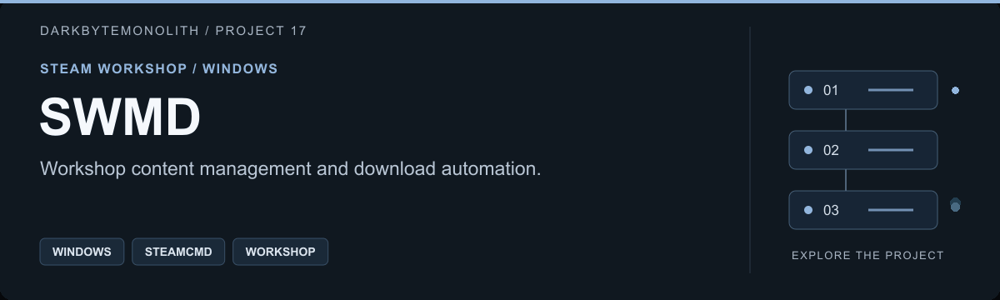
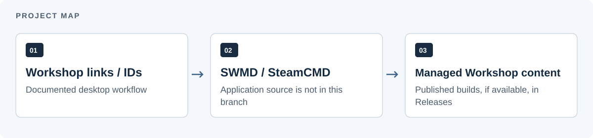

<!-- readme-design:start -->

  <picture>
    <source media="(prefers-reduced-motion: reduce)" srcset="docs/readme/hero.svg" />
    
  </picture>

  
  
  

<a href="#features">Features</a> · <a href="#download">Download</a> · <a href="#requirements">Requirements</a> · <a href="#usage">Usage</a> · <a href="#version">Version</a>

<table>
  <tr>
    <td width="33%" valign="top"><b>Workshop</b> Individual mods and collections.</td>
    <td width="33%" valign="top"><b>Management</b> Updates and download settings.</td>
    <td width="33%" valign="top"><b>Distribution</b> Documentation-only source branch.</td>
  </tr>
</table>

<!-- readme-design:end -->

> [!NOTE]
> This branch contains the README only; application source and a build script are not included. The download instructions below refer to separately published release assets, if available.

SWMD (Steam Workshop Mod Downloader) is a Windows desktop application for downloading and managing Steam Workshop content, powered by SteamCMD.

## Features

- Download individual Workshop mods by link or ID
- Download entire Workshop collections
- Update all mods and collections automatically
- SteamCMD integration for reliable, up-to-date downloads
- Parallel downloads with adjustable concurrency
- Built-in proxy manager
- Game name lookup and Workshop info fetching

## Download

Grab the latest standalone executable from the [Releases](../../releases) page.

## Requirements

- Windows 10/11 (64-bit)
- Self-contained build — no separate .NET runtime required

## Usage

1. Download `SWMD_v1.2.0.exe` from Releases.
2. Run the executable.
3. Paste a Workshop link or ID and start downloading.

## Version

v1.2.0
